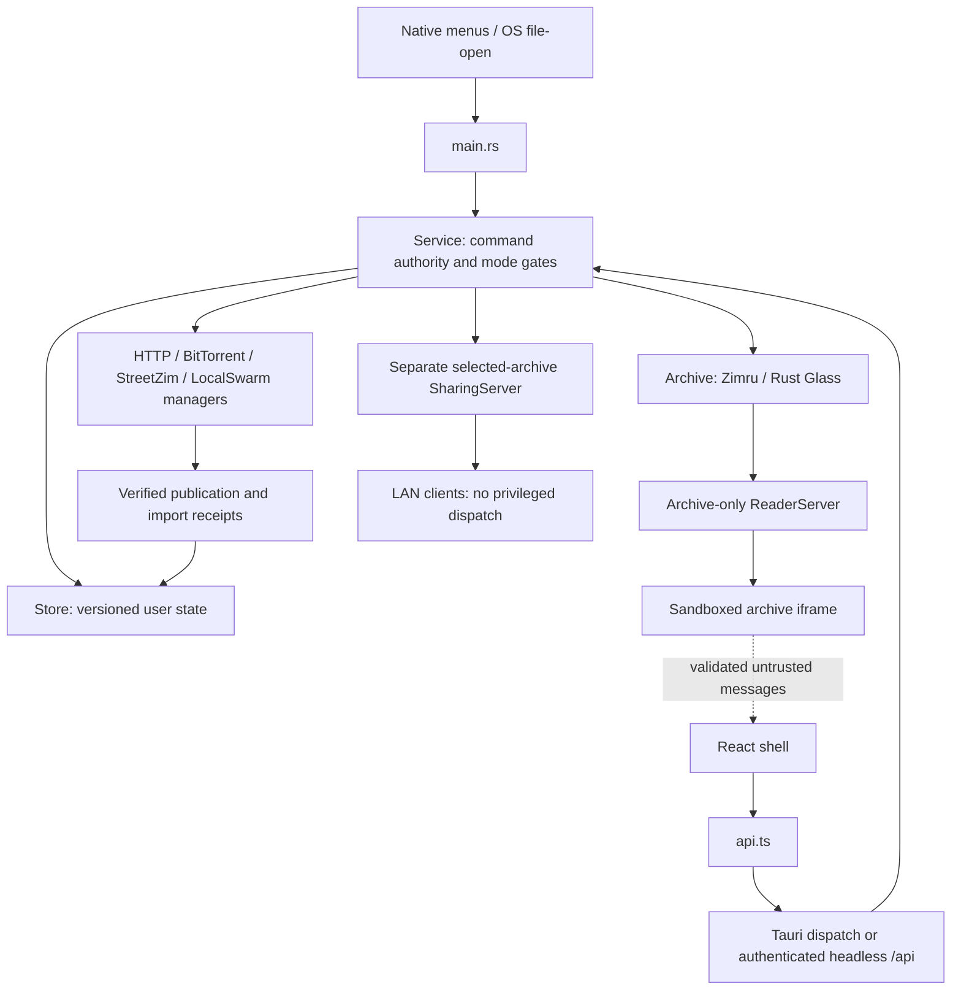

# Architecture and contributor guide

This describes the checked-in implementation, not a runtime certification. All paths are relative to the repository root. Build commands and dependencies are in [README](../README.md) and [PACKAGING](PACKAGING.md). No Qt, Swift, Core Data, libkiwix, aria2 executable, or sibling repository is required at runtime.

Every job manager, lifecycle gate and shell state machine (states, invariants, transition tables and known reachable invalid states) is catalogued in [STATE_MACHINES](STATE_MACHINES.md); update it with any transition or guard change.

## Boring ownership boundaries



The design deliberately uses ordinary modules, explicit commands, bounded blocking work, and one versioned state owner instead of a parallel framework or plugin hierarchy. Each job manager owns its jobs; the library owns only published archive references. `complete` transport is not synonymous with successful library import. Errors remain actionable rather than replaced by successful-looking placeholders.

## Startup and UI

- `src-tauri/src/lib.rs::parse_options` handles desktop archive paths, `--article`, data directory, privacy/read-only, headless, and port flags. On Unix desktop startup claims the profile lock before the builder and the owner publishes `<profile>/instance/rendezvous.sock`; a second launch therefore activates the owner (forwarding its argv/cwd through `parse_options` and `validate_secondary_launch`) or, when no owner is reachable, shows a dialog naming the profile and exits 0 without touching it. Non-Unix keeps the identifier-keyed plugin, and a store open that loses the profile there is a typed `StoreOpenError::Busy` routed to the same dialog instead of a setup panic. A secondary launch inherits the running profile/modes when flags are omitted; incompatible explicit `--private`, `--read-only` or `--data-dir` requests are refused before import with an actionable error. Cold/warm file-open requests route through `open_paths`; foreground requests remain subject to OS behavior. `main.rs` delegates to the shared library entrypoint.
- Native `setup` creates the `Service`, installs menus, imports requested files, restores registered window geometry/session data, and starts background maintenance. Catalog fetches and downloader construction are not prerequisites for opening local content.
- Launch locations remain in a service-owned in-memory queue with stable launch IDs and trusted target-window labels. Snapshots expose only the caller window's locations; `kiwix-open` is a wake signal, not an authoritative location payload. The frontend consumes stable-ID tabs and acknowledges selected IDs with the current privacy generation, so a missed wake does not lose queued opens and another window cannot drain them. Startup targets `main`; this queue is not a durable replacement for saved sessions.
- `src/App.tsx` owns navigation, movable tabs/closed-tab stack, session-save ordering, per-tab reader workspaces and privacy generations. `Reader.tsx` owns the active iframe lifecycle, bridge validation, sensors, local previews and trusted-shell external-link/attachment confirmation. Search/bookmark drafts survive Reader remount without retaining sensor authority. `UnifiedSearch.tsx` searches local open tabs, bookmarks and history together; new-tab search can reuse privacy-gated recent queries. UUID-keyed book zoom overrides span 25–500%, with reset to the global reader default.
- `src/platform.ts` sets `data-platform` on `<html>` (`ios`, `android`, `macos`, `windows`, `linux`) from `TAURI_ENV_PLATFORM`, falling back to the user agent in the headless browser preview; development builds accept `?platform=` to preview another skin. `src/platform.css` loads after every other stylesheet and restyles the shell per platform. Palettes and shared shape tokens (`--control-height`, `--control-radius`, `--field-radius`, `--panel-radius`, `--focus-*` and others, declared in `src/styles.css`) are overridden on `:root[data-platform]`; component overrides repeat the base selector behind `:where(...)` so they keep its specificity. Properties that class rules never reset, such as shadows or label weight, target only standard push buttons (`button:where(:not([class]), .primary, .danger:not(.icon-button))`). Hover styles live inside `@media (hover: hover)`. `applyWindowTheme` mirrors the theme setting into the native window theme. On macOS (`usesOverlayTitleBar`), windows from both `tauri.conf.json` and `src-tauri/src/windows.rs` use an overlay title bar with the traffic lights at (16, 13); the sidebar's `.titlebar-drag` strip and the `data-tauri-drag-region="deep"` workspace bar are the drag regions, and `data-titlebar` switches to `fullscreen` when the window is full screen so the insets disappear. Desktop release builds suppress the webview's context menu except on editable text and selections; React handlers that show their own menu are unaffected.
- `src-tauri/src/windows.rs` creates incognito native views, records/restores portable geometry, bounds window size, and recenters offscreen geometry. `src-tauri/tauri.conf.json` configures the main incognito view. Windows are bounded to 16 and tabs to 200 per window. This is not Apple's native NSWindow tab-group implementation.
- `src-tauri/src/menus.rs` owns native menu accelerators and emits trusted shell events. Archive messages do not authorize native tab/file/window actions. React handles the resulting shell event; browser/headless mode has its own trusted keyboard path.

A mobile background checkpoint distinguishes an authoritative hydrated session from a never-hydrated cold root. Before suspension or asynchronous work, the cold branch fences outstanding refresh callbacks through their existing serial, then freezes reader storage and drains pending preferences plus the captured session queue. It never saves initial empty tabs/settings, manufactures hydration, or starts a replacement background snapshot. Foreground refresh performs the real initial restoration before normal session writes resume. Hydrated checkpoints and explicit Quit/close retain their full original flush, generation checks, error propagation and native acknowledgment authority.

Terminal retirement is app-owned. `Service::shutdown` closes admission, joins accepted archive work and reader/sharing/import workers, checkpoints transfers and returns aggregated cleanup failures. Native final provider release and process exit require successful preceding retirement. Android service cleanup uses an application-context endpoint after Activity destruction; non-finishing/configuration destruction remains nonterminal. Document worker/main/cancellation-worker/main barriers run before closing the executor.

## The archive/privilege boundary

### Archive HTTP origins

`server.rs::ReaderServer::start` binds an ephemeral listener on `127.0.0.1`. Each archive/window listener uses a fresh `http://<archive-UUID>-<nonce>.localhost:<port>/` **root** origin, not an archive path prefix. Root-relative archive assets and Fetch stay inside that archive. Host and request-origin checks, bounded bodies, path decoding, actual MIME types, UTF-8 HTML handling, same-archive redirects, and single byte ranges live here. Non-HTML resources stream in bounded chunks through Zimru; HTML is bounded before bridge injection. Errors are plain text under a restrictive CSP, not metadata interpolated into trusted HTML.

For validated HTML within the existing read limit, `injected_html_body` retains
the original article allocation as shared `Bytes` slices around the injected
scripts. Three response frames preserve the exact concatenation without a second
whole-document buffer; partial consumers retain their owned bytes until drop.
HEAD still reads/validates the representation and reports its length, but does
not build a discarded response body. The first-64-KiB head scan compares ASCII
case-insensitively in place, preserving the old offset/fallback semantics without
lowercasing a temporary copy. Oversized streaming, source leases, CSP and
socket-level retirement keep their existing contracts.

`Service` keys listeners by native window and archive and registers trusted parent origins. A privacy/read-only transition increments an epoch, retires and joins listeners, invalidates prior writes, and deactivates sensors. Revocation remounts content on a fresh origin. New nonce hostnames prevent accidental browser-origin reuse even if a TCP port is recycled.

Archive CSP restricts network/resource access to the archive (plus explicitly allowed data/blob resources), permits child frames only at that exact nonce-bearing archive origin, blocks plugins, and denies microphone/display capture. Child frames have no independent shell-message authority; same-origin archive content can reuse an explicitly granted archive capability, so injected JavaScript is not a native security boundary. Service-worker script requests are rejected. Service-worker-dependent Zimit archives are unsupported, rather than advertised as universally compatible. Dedicated-worker, WASM, codec, WebGL, and Fetch behavior still requires packaged platform fixtures.

### Narrow content bridge

`src/reader-bridge.js` reports document navigation, title, headings, selection, find/speech state, resource requests, and sensor requests. `Reader.tsx` checks the active frame source, exact origin, channel/version/session, shapes, lengths, and lifecycle before using messages. The bridge is **untrusted content input**, not a source of authority. Archive-reported external links require a separate trusted user confirmation and service-side `http`/`https`/`mailto` allowlist; archive bytes are not passed to an arbitrary shell opener. Native application accelerators never originate from this channel.

`src/storage-bridge.js` supplies compatibility localStorage/document.cookie/Cookie Store behavior. Persistence in `State.reader_storage` and native sensor decisions are scoped by the app-generated `Book.installation_id`, never the ZIM's untrusted catalog UUID or an ephemeral origin. A checksum-valid ZIM can copy another ZIM's UUID: the earlier Tauri baseline reproduced site-data inheritance through that collision, so conflicting paths must not silently replace an installation. Explicit relinking rotates its identity and retires old frames/consent; controlled verified moves preserve identity. Only expiry-bearing cookies survive restart. Private-mode mutations stay in memory; read-only changes remain transient. All native webviews are incognito; native IndexedDB persistence and OS-wide no-I/O behavior are not promised.

`src/reader-storage.ts` is a shell-lifetime owner, not a Reader effect. It binds each frame `WindowProxy` to the exact origin, archive and privacy generation before navigation, validates bounded mutation batches, and serializes writes independently of component remounts. Weak bindings retain authority for already-posted detached-frame mutations; retryable write failures retain their original batch IDs and ordering. `flushReaderStorage` is a nonfreezing barrier: drain live frames, fence already-posted messages and await queued writes. `freezeReaderStorage` also gates new navigation admissions, including pending native open/activation replies, and navigates current documents to their native-supplied same-origin retirement document. Before any navigation, registered retirement callbacks synchronously revoke sensor/speech admission; native sensor deactivation is awaited in parallel with the document handoff. Frames stay connected through genuine `pagehide`, authenticated successor acknowledgement and durable flush. Quit/window-close/active-tab-close retain the restoration lease until retirement and restore on cancellation; private/read-only cutover keeps the old generation retired until remount on success, or restores on failure. Coalesced freeze leases restore only after the last lease resumes, and `resume(false)` suppresses restoration after successful close. The service still validates generation/session binding and owns durable state; draining cannot authorize writes from a retired generation.

Navigation can deliver a real storage `MessageEvent` with `source === null` while preserving its browser-authenticated exact origin. This is a storage-only exception, not a relaxed Reader/sensor bridge. A null-source batch/close must uniquely match an existing document stream by exact origin and document nonce, with the original generation, sequence, credit and failure checks intact. A drained reply resolves only its own existing drain ID, expected document nonce and exact origin, even if close already released the stream. A null-source initial ready may recover only an already-registered exact-origin/generation authority with one distinct live source and one book identity; repeated registrations of that same tuple are equivalent, but multiple sources or conflicting identities fail closed. Registration refuses to redefine an existing nonce origin's book/generation. Origins and document UUIDs are not secrets: the security assumptions are browser-enforced origin authenticity, native fresh nonce origins scoped to one archive/window/installation generation, and no archive access to the trusted shell realm. Root replies use the recovered bound `WindowProxy` and include the original document nonce, so a replacement document ignores another document's credit/acknowledgement. Native installation identity and generation checks remain authoritative.

Storage backpressure is synchronous: each admitted navigation reserves a 2 MiB producer allowance under a shared 16 MiB shell cap that includes unused allowances and queued bytes from active, detached and older frames. Setters throw `QuotaExceededError` before mutation or sequence advance when credit is exhausted; only a matching native-success batch/document/sequence acknowledgement replenishes credit once. Local/cookie state has a combined 1 MiB quota with UTF-8 field bounds; read-only storage stays transient without mutation relay. A completed-document close or authoritative generation retirement releases unused producer credit. For a reused live `WindowProxy`, a trusted real iframe load snapshots superseded, unconsumed registrations; a root posted-message fence receives already-queued old messages before those still-unused reservations are released. The active registration and registrations created after the snapshot are not reclaimed at that ordinary load boundary. A same-origin successor's authenticated storage-ready establishes the next current document after outgoing pagehide dispatch; both ready and late hiding delivery trigger fenced settlement of older hiding streams. Explicit authenticated retirement closes every outgoing stream and unused source reservation, irrespective of whether its advisory hiding packet has arrived. Closing credit never discards accepted queued bytes: root owns them until native durable acknowledgement. Retained weak identity still authenticates ordinary late ready messages, which must reacquire allowance under the same cap or explicitly fail; retired bindings cannot reopen. Garbage collection remains a fallback for detached contexts, never a prerequisite for live-context credit recovery; there is no speculative timeout reclamation. Invalid streams fail visibly and fail their drain without blocking other documents. Retiring a generation warns about pending lost edits and discards that generation's queue so it cannot poison the new session; admission can refuse a frame when capacity is unavailable.

Ordinary replacement navigates the same iframe browsing context instead of removing it: DOM removal alone does not reliably run `pagehide`. The bridge's capture listener posts advisory `kiwix-storage-hiding` with its existing document nonce, sequence and generation. Later archive pagehide handlers and their microtasks remain writable; the advisory sequence is not final and can precede the stream's latest accepted sequence. For ordinary same-origin navigation, the next document's storage-ready and a root posted-message fence establish completion; settlement rechecks the connected frame, active binding and latest ready document, excluding that current document even when hiding arrives late. BFCache ready clears hiding and reacquires backed credit; its committed-sequence watermark prevents duplicate replenishment from delayed acknowledgements. Explicit retirement instead validates the native-supplied exact-origin `/.kiwix/<32-lowercase-hex-token>/retire.html` URL and independent 32-hex `retirementProof`, then navigates with only a fresh UUID `?retire=` challenge. The server-owned, no-store document runs a nonce-CSP script, has no archive storage/sensor/native-IPC bridge, and posts `{ type: "kiwix-storage-retired", id, proof }` only to its configured parent origin. Its navigation-only iframe route rejects script fetches; the proof is privileged native response/document content, never in the navigation URL or archive bootstrap, so observing a Navigation API destination does not permit an old document to forge acknowledgement. Root requires exact non-null source, origin, challenge, proof and message shape, fences messages, rechecks the same connected active frame, closes all outgoing source credits and durably pumps accepted batches before removal. No acknowledgement within five seconds fails explicitly and restores the latest validated article URL. The ordering assumption is same-origin successor execution after all outgoing pagehide callbacks and their microtasks, with their posts sharing the browsing context's delivery channel; a cross-origin `about:blank` load did not provide that guarantee in the reproduced runtime. If an ordinary successor never executes the bridge, root conservatively retains its allowance until authenticated retirement. This relies on neither unload, speculative timers, journals nor a dynamically installed pagehide tail listener. Closed, inactive consumed bindings are released.

`registerReaderStorage(source, binding, frame, onRetire, onRestore)` must run before setting the frame URL; null admission forbids navigation, and disposal relinquishes active ownership without revoking already-posted document storage authority. The binding carries the native retirement URL and private acknowledgement proof. The owner invokes `onRetire` synchronously before document navigation to invalidate pending article opens, revoke bridge-held devices, cancel requests and stop accepting sensor messages; its native-deactivation promise is awaited alongside the document handoff. The callback must not remove the iframe. Pass the real iframe so trusted loads can settle abandoned reservations. Reader calls `updateReaderStorageLocation(source, { origin, privacyGeneration, url })` immediately after registration and after authenticated source/origin/session/generation and archive-path validation of ready/navigation reports. The storage owner also requires the active binding and URL origin to match. Rollback uses the binding's latest validated article URL, not the stale `iframe.src` attribute. Only after retirement admission is ungated and every freeze lease is released does it invoke `onRestore(url)` to rearm Reader's validated navigation/ready lifecycle; without a callback it assigns the frame URL directly. Failure rollback follows the same deferred path, and a committed-close `resume(false)`, retired privacy generation, replaced binding or disconnected frame prevents restoration.

Storage lifecycle browser acceptance contract (execution evidence is recorded separately in the [changelog](../CHANGELOG.md#verification-and-known-limits)): use actual navigation/removal, not synthetic lifecycle events. Register capture/bubble `pagehide` handlers after bridge injection; write distinct values synchronously and from nested microtasks. Verify internal same-`WindowProxy` navigation, at least twelve Reader/pane replacement cycles, and BFCache restore where supported. Delayed acknowledgements must not lose accepted writes, duplicate credit, exhaust leaked reservations or replay retired generations. Hold acknowledgements to exhaust the shared 16 MiB budget, require synchronous backpressure, then release and verify recovery. Trusted-App freeze immediately gates new reader admissions and sensor authority; outgoing documents retain writable storage through genuine pagehide and nested microtasks until authenticated retirement settles them. It must not reject those final setters merely because the parent started freezing.

```mermaid
sequenceDiagram
    participant Frame as Archive storage shim
    participant Root as Shell storage owner
    participant Service as Service / Store
    participant App as Trusted shell lifecycle
    Frame->>Root: Bounded batch + document sequence
    Root->>Service: Ordered, identity-bound write
    Service-->>Root: Commit or visible failure
    Note over Root: Failure retains queue head for retry
    App->>Root: Gate new reader admissions
    Root->>Frame: Deactivate sensors; navigate to trusted handoff
    Note over Frame: Genuine pagehide handlers and microtasks stay writable
    Frame->>Root: Final batches, then authenticated handoff proof
    Root->>Root: Fence events; reclaim outgoing producer credit
    Root->>Service: Await accepted writes and sensor deactivation
    Root-->>App: Retirement complete, or explicit failure
    alt Transition succeeds
        App->>Frame: Remove retired iframe
        App->>Root: Release lease without restoring old reader
    else Transition is cancelled or fails
        App->>Root: Release freeze lease
        Root->>Frame: Reactivate through ordinary reader admission
    end
```

Native lock order is closed-window guard → Store. A transaction that already owns Store must not call `ensure_window_active` and reacquire the closed-window mutex: concurrent archive-storage writes use the opposite edge and can deadlock. Zoom, recent-search, session and visit updates obtain `active_window_guard` before entering Store and retain it through the commit. The actual prior hang was sampled; a subsequent concurrent 50-storage/50-visit scenario committed completely. This is not proof that every unrelated native lock graph is acyclic.

### Privileged shell and headless mode

Native `dispatch` inserts the actual window label; JavaScript cannot select another native window's authority. Tauri capabilities are in `src-tauri/capabilities/`.

`server.rs::start_preview` serves the **real app and service**, not a mock, on a fresh `kiwix-shell-<nonce>.localhost` loopback origin. `/api` requires POST, the exact shell Host/Origin, and the launch-specific bearer token. The fragment bootstrap URL conveys that token; treat it as a local capability. The privileged shell origin can never be an archive's origin, including after port reuse. Headless is not LAN sharing and should not be reverse-proxied as a public API.

## Archive access and search

`archive.rs` retains the admitted files and provider leases for all reader operations. The MIT Zimru dependency interprets ZIM data using positioned reads across those files. The separate GPL Glass engine reads embedded indexes from the same source. Redirects, metadata, illustrations, article ranges, title enumeration and structural checks use safe Rust APIs. `Service::archive` maintains a 16-slot cache keyed by archive UUID, installation identity and path. Concurrent callers share initialization. An evicted slot can finish for its existing callers, and a failed initialization can be retried.

Each archive admits one public operation that can decode content at a time across its clones. Content responses use bounded ranges and the archive's decoded-cluster cache. Verification hashes the retained parts, then scans their structure using a fresh reader and checks the referenced blob indices. Background import and integrity workers can cancel while queued or between bounded reads.

On a 64-bit desktop with at least four available processors and 128 archive clusters, verification samples the compression types in batches of up to 4,096 clusters. A batch containing a sampled Zstandard cluster can use four workers sharing one reader and one cluster-offset table. Each worker admits at most 4 MiB of stored data, 4 MiB of decoded data and an 8 MiB declared Zstandard window. After the workers join, the ordinary verifier checks every remaining cluster under its existing limits. This includes raw and XZ clusters and Zstandard clusters that exceed a worker limit. Mobile builds, 32-bit builds and smaller workloads use sequential verification. Timing and peak process memory on one Mac are recorded in the [verification benchmark](benchmarks/2026-11-18-bounded-archive-verification.json).

`search.rs::run` queries selected available archives through the Rust Glass reader, exposes per-archive errors, combines identified hits with deterministic rank fusion, and slices global pagination using bounded page buffers. `search.rs::suggest` pages title-only suggestions book-major through the same archive handles, refuses a continuation token whose digest does not match the prefix and resolved scope, and reports per-archive errors without blocking later archives. `Reader.tsx` and `Library.tsx` retain request identity so stale results cannot overwrite a newer query; the Library suggestion popup debounces 120 ms and reuses the search owner's cancellation scope. Full text requires an archive index. `spelling.rs::SpellingManager` builds the checked Rust word index from public titles after an explicit user request. Builds require a writable session and bind the index to the installed book and its retained archive files. Each index is capped at 20 million titles, two million words and 1 GiB. A background read-only worker validates an existing cache once per source. Candidate and query bounds constrain suggestions. [Spelling storage and measurements](benchmarks/2026-11-18-spelling-index.md) This is app-level assistance, with its own language coverage. Slow network archive I/O is kept off async/UI workers; actual mixed-NAS latency still needs measurement.

## User state and migration

`store.rs::Store` holds an exclusive OS file lock for its lifetime and serializes updates through a mutex. Profile schema v2 stores app-owned installation identities alongside books, bookmarks/notes/tags, history, explicit tab locations, per-window sessions/geometry, settings and installation-keyed compatibility storage. The v1 migration assigns trusted identities and rekeys existing registered storage once; writable profiles commit the migration atomically, whereas read-only startup migrates only in memory. Validation rejects malformed or duplicate installation identities. Transactional replacement tracks commit/durability errors; malformed profiles are never silently reset.

Private mode separates visible transient browsing data from the persisted normal session. Explicit library/bookmark/download actions are not the same thing as passive browsing persistence. CLI `--read-only` cannot be disabled by an in-process settings update; startup requires existing state and lock files and does not create/repair the profile. Service write gates also cover acquisition, exports, logs, and sharing—not merely `Store::update`.

`catalog_index.rs` reconciles source-scoped OPDS metadata on explicit request, using the existing conditional page cache. Configured source roots preserve meaningful query parameters; entry keys retain opaque Atom IDs rather than assuming an ID is a ZIM UUID. Each bounded traversal revalidates current linked pages and reports partial/stale results. Offset pagination is not a publisher-atomic snapshot, and an omitted edition never authorizes installed-archive deletion. Edition matching distinguishes source/series identity from a native installation principal; ambiguous or unbound lineage requires explicit user association rather than a title-only update guess.

`edition_updates.rs` and `edition_service.rs` retain full-download intents and native preparation/verification state. Downloads remain separate from the installed archive until explicit review and replacement. The cutover atomically migrates bookmarks/history/live and saved tab locations and per-book zoom, emits durable reference transitions for delayed shell/session work, assigns a fresh installation principal and retains original archive bytes. Rollback verifies the retained original and performs another fresh-principal transition; neither direction inherits website storage, sensor permissions or sharing consent. The running shell adopts reference revisions, including unsaved reader drafts, rather than dropping a tab when its former archive UUID disappears. Official HTTPS replacement/read/rollback was exercised on the host; packaged platforms and broader interruption/provider acceptance remain separate.

Bookmarks own persistent passage highlights: a UUID, encoded document location, UTF-16 position, exact quote, bounded surrounding context and comment. Old profiles default to no highlights. Native validation bounds each bookmark to 200 entries, quotes/comments to 16,384 UTF-16 units and contexts to 128. `save_bookmark.highlightChange` applies add/comment/remove against the latest Store transaction; ordinary note edits omit highlights. Annotation deltas preserve concurrent notes, titles, tags and unrelated passages; commenting on a deleted passage fails instead of resurrecting it. Explicit full-array replacement remains available for intentional interchange, mutually exclusive with a delta.

The trusted Reader maps persisted bookmark IDs to fresh bounded wire tokens; arbitrary legacy IDs never enter the archive bridge, and stale render-token replies are ignored. The bridge indexes bounded non-control text, validates position/quote/context, and uses only a unique valid contextual fallback. Ambiguous or absent passages stay unpainted with a visible status. CSS Custom Highlights and a calibrated shadow-overlay fallback avoid rewriting archive text nodes. The fallback inverts its measured local-to-viewport transform, including reader zoom. Each document displays at most 1,000 annotations in batches of 200; indexing is capped at five million UTF-16 units/100,000 visited nodes, fallback scanning at 25 million units/50,000 candidates and visible overlay rectangles at 10,000. These are resource bounds, not a promise to anchor every dynamic archive.

Only rendering anchors and opaque per-render bookmark tokens cross into archive content. Personal comments, bookmark notes/tags/titles and persisted bookmark identities stay in the trusted shell; archive scripts can observe ordinary `postMessage` traffic, so a type annotation alone is not a privacy boundary. The producer uses an explicit field projection rather than spreading persisted highlights.

Private reading synchronization is a separate authority from public archive sharing. `private_sync.rs` uses maintained Snow's `Noise_XX_25519_ChaChaPoly_BLAKE2s` with an application/version prologue, bounded authenticated frames and fresh ephemeral transcripts. A five-minute QR/copy invitation pins the responder's native static public identity; its random session token travels only inside the encrypted connection. Both trusted screens show the same transcript comparison code, and both explicit confirmations precede durable enrollment. Reading payloads require a fresh connection that finds both static identities enrolled and enabled; public HTTP/QUIC/archive discovery never dispatches this protocol. The separate TCP endpoint binds an OS-confirmed local route and checks numeric peers with the stricter on-link policy. Optional automatic sync runs only while active; private/read-only transitions, suspension, shutdown and revocation cancel sockets and ephemeral sessions.

`private_sync_identity.rs` retains the installation secret outside portable reading data in `private-reading-sync-v1/identity.x25519`. The identity has no serialization or debug implementation and uses zeroizing native secret storage. Capability-relative no-follow opens, owner/private-permission checks, file-identity rechecks, no-clobber publication and file synchronization protect creation/reload. Unix directories and files require 0700/0600 permissions and directory synchronization. Windows uses a protected current-user DACL and flushed-file, handle-relative publication; it does not claim POSIX directory-entry power-loss durability. Unsupported permission/ACL/filesystem primitives fail closed rather than falling back to a public application identity.

Invitation tokens are consumable native zeroizing values, cleared after encrypted handoff/claim and on terminal cancellation/error/expiry; native serialized/decrypted frame buffers are zeroizing too. This does not claim complete process-memory erasure: Snow 0.10's default resolver and internal handshake state retain raw key arrays without zeroizing destructors, and frontend/clipboard invitation copies are outside native buffer ownership. Session/socket authorization retirement and forensic heap/register-remanence protection are distinct guarantees; only the former and cleanup of application-owned secret buffers are promised by this feature.

`reading_data.rs` projects only versioned bookmark locations/title/note/tags/highlight anchors/comments and per-replica reading-position candidates. It excludes archive bytes, provider grants, installation principals, filesystem paths, storage/cookies, sensors, searches and active tabs. Store transactions capture local producers with a native replica/counter and causal multi-value scalar registers; remote apply shares the atomic visible-data/causal commit but suppresses recapture. Different fields/passages merge independently, parent/highlight tombstones defeat stale edits, explicit recreation has a new generation, and same-field siblings remain explicit conflicts. Resolution compares the exact alternative IDs the user reviewed inside the commit before superseding them. Positions remain per-device candidates; history retention is not remote deletion, and resuming a candidate uses an installed local archive through normal reader navigation without replacing unrelated tabs.

Tracking begins with explicit category admission, not an implicit copy of every existing history entry. Enabling a category fully validates and bounds its initial baseline in the same transaction; failure leaves the normal local profile and consent unchanged. A large existing history therefore does not block unrelated settings/session/bookmark persistence while sync is unconfigured, and bookmarks can be admitted with positions left off. Once a category has been admitted, local mutations continue to be tracked while sharing is disabled so later consent does not erase tombstones or miss offline edits. Profile recovery never treats an undecodable causally tracked bookmark as an authored deletion; mobile profiles containing causal/trust metadata fail closed instead of replacing that history with a new empty profile.

Causal/tombstone growth is bounded without implicit pruning. Explicit confirmed sync-history reset revokes devices, rotates the causal replica and rebuilds the visible local baseline only after conflicts are resolved; bounded retired-replica barriers reject pre-reset causal events even after re-pairing. Old devices must explicitly reset their history before reconnecting. Category disable is consent, not deletion. Native durability errors after replacement retain the committed state and never generate a false durable transfer acknowledgment. Real two-process desktop and browser flows exercised pairing, transfer, conflicts, deletion, replay/restart, revocation and privacy cutover; packaged platforms and mobile lifecycle acceptance remain separate, not consequences of cryptographic library choice.

If live saved positions themselves fill the bound, **Clear saved sync positions and reset connections** is a separate destructive, confirmed recovery action. It forgets synchronized position candidates and revokes device connections using the same retired-replica barrier, while preserving local reading history, bookmarks/notes and tabs. Unchanged history/tab records do not silently refill the cleared candidates; subsequent actual reading-position changes create new candidates. Other devices must explicitly reset before reconnecting.

`migration.rs` parses legacy library XML, local-library OPDS feeds, bookmark XML and versioned JSON reading lists. Explicit local-library import resolves local acquisition paths against the selected original directory, retains missing references and imports available archives; this is separate from remote catalog discovery and still needs broad producer acceptance. Reading-list import deduplicates complete archive+location identities, preserving query/fragment. This application's JSON and XML extensions both preserve IDs, creation time, notes, tags and anchored highlights/comments; older XML clients may discard unfamiliar extensions. Automatic Qt root discovery, QSettings/session conversion, legacy download resume, Apple Core Data/security-scope migration, opaque WebKit state and URLSession resume translation are not implemented.

`library_files.rs` owns explicit filesystem actions: reveal-folder, verified exact split-set trash/deletion, managed-download relocation and journal recovery. It derives contiguous part names from the ZIM checksum boundary rather than filename prefix globs, verifies UUID/integrity/identities, and stages destructive actions in private directories. Changing Settings' download directory offers migration of managed archives, not imported originals. Owned per-part SHA-256 journals preserve recovery state; same-filesystem no-replace renames and cross-volume verified copy/publication have distinct ordering. Cross-volume sources are captured and identity-checked before unlinking, only after destination verification and durable profile commitment. Errors retain recoverable files rather than sweeping unknown paths. `storage.rs` queries native filesystem identity for the known FAT/FAT32 single-file limit, including final outputs and individual cache chunks; exFAT is not FAT32. Neither logic is evidence of real crash/volume acceptance.

## Acquisition, maps, and publication

- `catalog.rs`: bounded namespace-aware OPDS/Atom parsing, HTTPS URL/redirect resolution, acquisition metadata and OpenSearch pagination. Producer facets select locale/base-language/fallback labels; raster thumbnails are fetched through a bounded native proxy/cache rather than untrusted browser URLs. `Catalog.tsx` rejects stale responses, applies persisted language/category/content selections and offers explicit external online preview confirmation. Shared `UI.tsx` facets, metadata sorts, publication dates and flavor/content badges serve library and catalog; catalog sorting is page-local. Catalog, acquisition and StreetZim clients identify the app/version/platform. Feed metadata/localized labels and external viewer compatibility remain producer-dependent.
- Large subsystems are split into submodules without changing behavior: `acquisition/` (persistence, manager API, segmented and single-stream transfers, finalization, HTTP/Metalink metadata), `torrent/` (manager API, confined storage, publication), `maps/` (partials, recipe model, manager API, composition) and `service/dispatch.rs` (the shell command table). Child modules glob-import their parent, and the parent re-exports them, so items keep their original names. Unit tests live beside each module in `<module>_tests.rs`.
- `acquisition.rs::DownloadManager`: durable jobs independent of library serialization; validators and exact range checks for HTTP resume; Metalink transport metadata; capacity checks; owned private part files; meaningful error/pause/interruption states; limit policy; post-transfer size/magic/hash checks. Job restoration honors explicit pause versus interruption/auto-resume policy.
- `torrent.rs::TorrentManager`: in-process librqbit, persisted ownership/job records, capability-rooted storage, safe publication, piece recheck on restart, bandwidth limits, explicit completed seeding, DHT/PEX and best-effort BEP 14 discovery. `torrent/web_seed.rs` fills BEP 19 HTTP `url-list` seeds into the same confined staging files, verifies every piece and then lets the engine hash/publish; Range resume, multi-file URL construction, padding, redirect/credential policy, retry bounds and verified-job skipping are documented in [WEB-SEEDS.md](WEB-SEEDS.md). BEP 14 is not ZeroConf/mDNS. No optimized fast-resume bitmap is trusted. Cancellation retains staging rather than asking the engine to recursively delete user files; BitTorrent can upload verified pieces during downloading even if post-completion seeding is disabled. Shutdown fences adapter storage and joins its workers; the underlying engine exposes cancellation/grace rather than a claim of joined network tasks.
- `maps.rs::MapManager`: shared Windows/macOS/Linux/iOS/Android StreetZim `streetzim-build-index/1` / `streetzim-recipe/2` pipeline, geographic/language selection, HTTPS bounded JSON/ranges, checked masks/offsets, verified local reuse, UUID/MD5/final-checksum checks, cancellation and no-clobber publication. Potential, not implemented: the StreetZim turn-by-turn Live Activity design and its background-location constraints are recorded in [STREETZIM-NAVIGATION-LIVE-ACTIVITY.md](STREETZIM-NAVIGATION-LIVE-ACTIVITY.md). `map_chunk_cache.rs` bounds disposable, rehashed source chunks to 8 MiB payload and 4,096 entries, evicts before the next temporary, and skips persistence of larger chunks. One foreground composition writes one growing output; restart rebuilds rather than trusts partial bytes. Terminal status survives restart. Downloads shows one canonical card with output progress and collapsed technical counters; maps do not acquire pause/resume or seeding semantics merely by sharing the UI.
- `publication.rs`: shared platform-specific no-replace publication and safe storage primitives; existing destination files are not silently overwritten. `imports.rs` runs bounded queued archive verification on a dedicated worker without profile writes. Only Service can register ready books under its writable-mode gate; persisted consumed-acquisition receipts make registration distinct from transport completion. Downloads/Maps expose verification/import errors and retry without discarding the published archive. Current identity/crash-recovery changes still need integrated acceptance.

Android completion notifications share the newly consumed verified-acquisition receipt gate, not transport completion. The existing Settings opt-in requests only `POST_NOTIFICATIONS`; disabled, private and read-only policies cannot post. `AndroidCompletionNotifications` keeps notice identities and a non-destructive tap queue in an atomic, no-backup application journal. Both cold and warm Activity intents resolve only a previously posted identity; intents never supply archive paths or installation authority. Rust checks the current consumed receipt, managed/available book, exact installation and native profile identity before exposing the archive's encoded main path through `launchLocations`, then checks them again at the root's foreground acknowledgement after tab/session acceptance. Acknowledgement durably consumes tap authority, and policy revocation retires outstanding identities so deleted, replaced and privacy-revoked notices cannot reopen an archive.

Map scratch payload comprises one output plus at most 8 MiB of owned chunk-cache payload. Filesystem rounding, metadata and journals add overhead; existing local inputs remain occupied space. Recognized legacy cache entries are pruned with cancellation checks, preserving unrelated entries. Capacity is checked on actual volumes and again after eviction, without assuming hard-linked/open-unlinked data was reclaimed. Verified output publication is a rename, not another full-file copy. Cache eviction can increase repeat downloads; native peak-allocation measurements remain workload/platform-specific.

Automatic monitored-folder registration loads metadata, then checks fresh live publication claims or bounded once-per-scan lazy-history snapshots before a Store transaction. App-owned pending, failed and recovery outputs cannot bypass acquisition verification. Claim paths are exclusions only, never admission or recovery authority. Map `monitoredPaths` retains prior completed destinations across job replacement and participates in explicit mobile/portable path rebasing. UUID-collision protection and explicit-import policy remain unchanged. On desktop, `watch.rs` adds live discovery without changing any of those rules: a bounded worker owns the `notify` watcher for the configured monitor directories, collapses events into a ~1 s per-file and per-directory stability window (bounded pending state, overflow downgraded to a directory re-check), and hands settled observations to `service.rs::apply_watch`, which re-checks private/read-only policy under the privacy read guard and calls the same `import_monitored_paths` or a disappearance-only library removal. The worker is stopped and joined before reader teardown; the periodic `library_maintenance` scan remains authoritative when the OS backend is unavailable or emits no events (for example network shares).

Accepted-job reporting uses required `DownloadAdmission` data: the initiating privacy context and whether the view still owns focus. HTTP/torrent, catalog, maps, deferred map confirmation and LocalSwarm report successful admission before component-lifetime guards. The root tracks accepted jobs only under the original current writable policy; closed views cannot suppress completion or redirect the user. Completion Open clears only the opened archive installation's notice.

Downloads lists current jobs followed by collapsed manual URL entry. Nearby sharing has its own primary navigation page with explicit Send/Receive and secondary manual connection details; native admission generations fence deferred download/resume after Stop across root windows. Technical details stay secondary; iOS omits filesystem paths even in expanded details/settings/metadata. Verified, available imports expose full-width named Open actions without completed progress bars. Low-storage and map/download cancellation use app-owned HTML dialogs, explicit trusted consent and current privacy/lifecycle/job checks instead of relying on WebView JavaScript confirmation behavior.

Every installed pathname remains reserved even when its archive is missing. HTTP, torrent and map publishers share the profile `Store` and run fresh no-replace commits inside `with_acquisition_destination`, holding the library mutation lock through the commit. Reservation comparison accounts for lexical, case, Unicode and Windows prefix/separator aliases without filesystem probes under that lock. A new acquisition cannot acknowledge an existing installation's UUID—even at the same path. Registration-only rejection is insufficient: publishing an unrelated file into an old missing pathname would otherwise let the existing record reopen it under its previous storage/sensor authority.

The map endpoints are external StreetZim-operated infrastructure, not Kiwix-owned infrastructure. Their production availability/ownership remains an external condition. The same Rust map implementation applies on Windows, macOS, Linux, iOS and Android; per-platform SDK, lifecycle, storage and renderer acceptance remain required.

## Export, devices, sharing, and diagnostics

`exports.rs` streams exact archive resources and original-article MHTML to temporary output then publishes atomically. MHTML recursively includes bounded static HTML/CSS references, not dynamically fetched JS resources or a live-DOM snapshot; ordinary HTML export is original bytes. `server.rs::resource_document` wraps images/audio/video and bounded escaped text/JSON/XML with the reader/storage bridges. PDF/EPUB and other unsupported inline formats retain instrumented navigation with trusted-shell Save/Open instead of sandboxed native plugins. `library_files.rs::open_attachment` requires explicit confirmation, a MIME/signature allowlist and a bounded owned extracted copy; archive messages cannot invoke an arbitrary OS opener. External apps may access the network. Print/PDF depend on platform rendering; desktop read-aloud retains system webview speech APIs. Internal link previews use bounded plain-text excerpts, throttled requests and session identity checks, not executable embedded articles.

`permissions.rs::SensorManager` tracks active archive/session/exact origin and separate camera/location `notAsked` / `granted` / `denied` runtime decisions per native window/archive. Block and Revoke remember denial; subsequent archive requests auto-reject without reopening the shell prompt. Only trusted Archive permissions → Ask again clears the selected sensor's decision. Revoke/reset cancel pending work and destroy the whole archive subtree/rotate its origin; privacy transitions clear grants and denials. Archive content cannot reset consent. `native/location.mm` implements macOS CoreLocation; other desktops use browser-provider paths where available. The native permission callback lacks a frame origin, so security depends on one active sandboxed archive subtree, exact nonce-origin Permissions-Policy, denied external frames/popups and subtree destruction on revocation. CSP permits child documents only at that archive's explicit network origin; injected children receive no shell navigation/speech/sensor authority. Same-origin descendants are not separate security principals and may share an already explicit archive grant. The JavaScript child restrictions are not the native enforcement boundary. OS metadata/entitlements alone do not prove grants or hardware work. Camera-only is supported by policy; microphone and mixed microphone requests are denied. Navigation/teardown cancels location requests and invalidates the session.

Ordinary mobile background/checkpoint retirement deactivates live sensor sessions and requests without clearing the archive's remembered grant or denial; actual privacy-policy changes still clear decisions. Native location completion revalidates the original session and exact request token under one lock. Retired/replaced work returns structured `code:2, cancelled:true`, not permission denial, including the interval before the root observes the background event. Reader forwards cancellation without a global error, and the bridge terminates its watch without retry or claiming OS denial. Real current denial remains `code:1` and cannot be hidden by a cancellation flag. For native-provider documents only, the Permissions API reports prompt before consent, denied after actual block/denial, and granted only after an authenticated successful fix; browser-provider and unrelated permission queries remain native browser queries.

The mobile command gate uses the same structured cancellation for lifecycle-rejected `sensor_location` and `sensor_consent` before reaching SensorManager. Trusted-root, closed-window and path checks keep their original precedence, foreground admission is unchanged, and the existing inactive authorization-dialog consent exception remains. Other suspended commands retain their ordinary error. This closes native-inactive-before-shell-event races without admitting sensor IPC while suspended or hiding real permission failures.

`kokoro.rs` is the optional offline neural engine: a pinned Kokoro ONNX pack is downloaded after explicit consent, phonemized by `misaki-rs` (including inflections and POS heteronyms), synthesized by sherpa-onnx, and played through rodio. Android reuses the `mediaPlayback` foreground service/MediaSession; iOS reuses the playback audio-session claim. `mobile_speech.rs` transports Android/iOS read-aloud to the actual native text-to-speech engines, independently of `window.speechSynthesis`. Only the trusted root can enumerate installed offline voices or Prepare/Start audio; archive bridge messages are not authority to start native playback. Each preparation binds a native-issued capability to the exact root window, active sensor/reader session, archive installation, listener origin and privacy generation. Private per-preparation native IDs prevent delayed callbacks from matching a reused root request ID. Preparing and retiring registrations count toward the eight-slot limit until native Retire completes.

Prepare alone serializes Rust reservation through native capability issuance, preserving the same ordering on both sides of the boundary. Native issuance ordinals can therefore reject an older delayed Start without interrupting newer playback. This preparation gate is never held by Start initialization or cancellation.

Source/session replacement, installation retirement, privacy changes, mobile inactivity/background and shutdown synchronously revoke ownership before waiting for reader/privacy gates. Start retains neither gate while native initialization waits. Stop/Retire require only the existing root-owned capability, so cancellation remains possible during inactivity or a queued privacy writer. Terminal callbacks retire the capability before forwarding root-only `mobile-speech-state`; a late Start acknowledgement cannot revive it. Stale native success is compensated with exact Stop and Retire, and errors remain native errors rather than a nonfunctional WebView fallback. These are source contracts, not runtime acceptance evidence.

Foreground reconciliation keeps interaction admission closed until an authoritative snapshot refresh and session flush complete under the new generation. A fresh native lifecycle query must still match the reconciliation revision and retirement before admission reopens. `native-speech.ts` additionally requires the activated reader frame and matching generation; voice discovery revalidates source identity before the native request, after its response and before reporting an error. Superseded work is discarded without hiding errors for the current source or relaxing backend authority.

Read-along highlighting is bridge-only paint. Desktop Web Speech reports `SpeechSynthesisUtterance.onboundary`; iOS `AVSpeechSynthesizer.willSpeakRangeOfSpeechString` and Android `UtteranceProgressListener.onRangeStart` report native UTF-16 ranges. `native-speech.ts` forwards the absolute offset (native chunk offset plus the resume base) to the reader bridge. The bridge extracts spoken text deterministically, keeps a run map from spoken-text offsets back to live text nodes, and paints the active sentence plus the boundary word through the CSS Custom Highlight API (`kiwix-read-aloud`, `kiwix-read-aloud-word`). WebViews without that API get an `aria-hidden`, `pointer-events:none` overlay in a closed shadow root; neither path wraps text nodes, rewrites archive markup, changes saved annotations, or enters the accessibility tree. Paint clears on pause, stop, terminal speech state, navigation, pagehide and privacy/session replacement; auto-scroll happens only when the sentence is fully outside the viewport. Boundary callbacks are advisory: an engine that emits no ranges leaves the starting sentence painted, and these callbacks are not proof of audible alignment on physical devices.

`sharing.rs::SharingServer` is a separate selected-archive HTTP service with token-scoped access and bounded script-free search. It supports loopback, IPv4-only, IPv6-only, dual-stack wildcard and enumerated local-interface bindings; scoped/link-local addresses are excluded rather than emitted as unusable browser links. `SharingControls.tsx` generates QR SVG locally, without an online QR service, and reveals/copies token-bearing URLs only through shell controls. `localization.rs` renders LAN pages from available locale catalogs; producer metadata and backend errors are not automatically translated. This service never exposes privileged dispatch and does not create Wi-Fi connectivity, HTTPS, a VPN, accounts or device trust. Only start on a trusted network; real peer/firewall/address-family and QR scanning acceptance remain required.

Capability activation sets an HttpOnly, SameSite=Strict cookie and presents a localized script-free **Continue** link: the extra click establishes same-site navigation rather than weakening cookies or using redirect/meta refresh. A no-referrer policy prevents the capability URL leaking through subsequent navigation. Stopping sharing revokes active socket I/O and response bodies, rejects queued native work and waits for in-flight native archive calls before reporting that sharing is off. These are implementation behaviors that still need real-client/platform regression acceptance, not evidence that a previously downloaded copy can be revoked.

`diagnostics.rs` produces user-requested local reports and opt-in local logging. Reports contain version/platform, aggregate library counts, privacy flags, and bounded categorized local events rather than arbitrary command arguments, article URLs, tokens, or paths. Inspect reports before sharing. This is not silent network telemetry. `check_updates` explicitly labels upstream Qt releases as a different channel and cannot install them into this independent build.

## LocalSwarm acquisition and offers

`src-tauri/src/localswarm/` owns v1 framing/manifest validation, exact-pinned QUIC, explicit DNS-SD browsing/advertising and capability-bound staging. It uses the existing publication/Store reservation and acquisition-import boundaries, not a second library importer. A registration error records an explicitly retryable failure for that receipt and does not abort other ready acquisitions; transport completion alone never acknowledges a library receipt.

Receive jobs never advertise or upload acquired chunks. An explicit selected-book offer retains verified source identities and is revoked on file/principal mutation. Source-admission guards span retirement and library remove/relink/move/recovery. Server/parser/writer tasks are cancelled and joined; retired native checksum workers hold read-only files with no publication/Store authority. Private/read-only/Stop admission tokens exist before lazy manager initialization.

The shared reference certificate and optional swarm PIN are not publisher identity. TCP is not advertised. Apple uses Network.framework QUIC with peer-to-peer/AWDL support and pinned shared identity; scoped DNS resolution, numeric on-link validation and required-interface binding precede outbound QUIC. Interface candidates are bounded/deduplicated; epoch-bound queue timers allow preflight fallback without reviving cancelled work. Native callbacks retain owning shared pointers, not reference parameters. iOS admits discovery attempts without an infrastructure LAN; the transport—not default NWPath connectivity—enforces locality/no cellular. Quinn's separate physical-binding/denial revisions remain intact for manual/mobile infrastructure connections. Other platforms retain the bounded vendored `mdns-sd` transport. See [LOCALSWARM](LOCALSWARM.md) for exercised routes and limits, and [PACKAGING](PACKAGING.md) for the mandatory matched schema-2 SDK.

## Change workflow and acceptance boundary

Reuse existing modules and command/data conventions. Keep native blocking archive/filesystem work off UI/async workers, validate at the privilege boundary, and keep job publication/import ownership explicit. Do not add aliases or parallel legacy engines for a clean cutover. Root commands use this repository's package manifest and native sources without sibling checkouts; direct Cargo/debug/headless builds embed the current `dist/` at compile time, so rebuild frontend assets before the native binary when changing shell code. Actual platform SDK/toolchain and runtime prerequisites remain mandatory; a macOS build is not a Windows build.

See [ISSUES](ISSUES.md) for individual observable acceptance cases, [FEATURES](FEATURES.md) for supported/partial behavior and [README evidence](../README.md#evidence-and-next-required-phase) for exercised boundaries. No checks were run for this documentation update. Integration owners should run root frontend/native builds, Rust suites and fixture acceptance, then actual packaged macOS/Windows/Linux, accessibility, camera/location, crash recovery and clean-machine packaging acceptance before strengthening status claims.

Final LocalSwarm integration and verification of applicable historical fixes remain open. Complete closed-issue/PR censuses for both predecessors are linked from [issue dispositions](ISSUES.md); those retrieval records are not proof that every applicable fix has been implemented or exercised.
